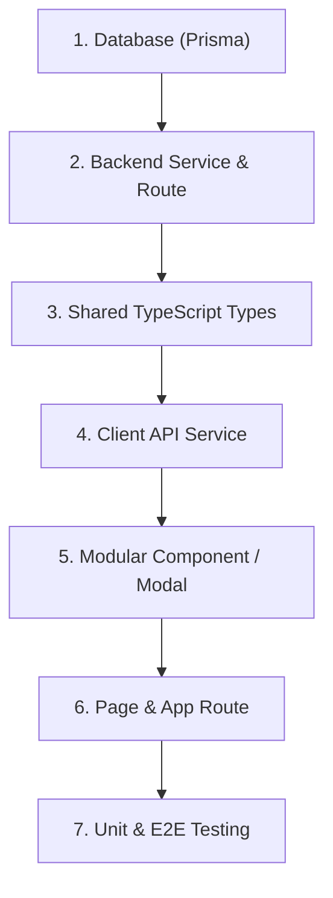

# Nakshi — Feature Implementation & UI Development Guidelines

This document provides a complete, step-by-step blueprint for building and verifying any full-stack feature in **Nakshi**. Use this guide to reuse existing architecture, design tokens, and testing pipelines efficiently.

---

## 1. Quick Reference: Essential Commands

Always run terminal commands from the **workspace root** (`e:\Nakshi`), unless explicitly noted.

### Development Servers
```powershell
# Run both Backend (port 5000) & Frontend (port 5173) concurrently
npm run dev

# Run only Backend
npm run dev:server

# Run only Frontend
npm run dev:client
```

### Database & Prisma (Backend)
```powershell
# Push schema changes to the live PostgreSQL database
cd server
npx prisma db push
cd ..

# Regenerate Prisma Client bindings after schema updates
npm --prefix server run prisma:generate

# Seed initial database records
npm --prefix server run prisma:seed
```

### Type Checking & Production Builds
```powershell
# Build both frontend and backend (validates TypeScript compilation)
npm run build

# Build only client
npm --prefix client run build

# Build only server
npm --prefix server run build
```

### Testing Pipelines
```powershell
# Run backend unit tests (Vitest)
npx --prefix server vitest run tests/unit

# Run a specific backend test file
npx --prefix server vitest run tests/unit/artwork_like.test.ts

# Run backend acceptance/integration tests
npm --prefix server run test:acceptance

# Run all Playwright E2E tests
npx playwright test

# Run a specific Playwright test (ALWAYS use forward slashes '/')
npx playwright test e2e/like_artwork.spec.ts

# Run Playwright test in headed mode (opens visible browser)
npx playwright test e2e/like_artwork.spec.ts --headed

# Launch interactive Playwright UI mode (debugger + timeline)
npx playwright test e2e/like_artwork.spec.ts --ui

# Record browser activity to auto-generate a Playwright script
npx playwright codegen http://localhost:5173/marketplace -o e2e/my_new_feature.spec.ts
```

---

## 2. End-to-End Workflow for Any New Feature



### Step 1: Database & Persistence (`server/prisma/schema.prisma`)
1. Extend the model or create a new model in `server/prisma/schema.prisma`.
2. Sync the live PostgreSQL database:
   ```powershell
   cd server
   npx prisma db push
   cd ..
   ```
3. Regenerate client bindings:
   ```powershell
   npm --prefix server run prisma:generate
   ```

### Step 2: Backend Logic & REST Endpoint
1. **Validation Schema** (`server/src/utils/`):
   Define Zod input validation schemas for request bodies/queries.
2. **Service Layer** (`server/src/services/`):
   Implement business logic using `prisma.<model>`. Throw `AppError(message, statusCode)` on errors.
3. **Controller** (`server/src/controllers/`):
   Extract `req.params`, `req.query`, or validated `req.body`, invoke the service, and respond with `res.status(200).json({ data })`.
4. **Route** (`server/src/routes/`):
   * Mount under standard REST paths:
     * Entity action: `POST /api/<entity>/:id/<action>` (e.g. `/api/artworks/:id/like`).
     * Resource collection: `GET /api/<entity>`, `POST /api/<entity>`.
   * Add middleware:
     * Authentication: `authenticateJWT`
     * Role authorization: `requireRoles(Role.ARTIST, Role.ADMIN)`

---

## 3. Frontend Implementation & UI Design Rules

### Step 3: TypeScript Interfaces (`client/src/types/`)
Define or update the data contract in `client/src/types/<domain>.ts`:
```typescript
// Example: client/src/types/order.ts
export interface Order {
  id: string;
  artworkId: string;
  buyerId: string;
  amount: number;
  status: 'PENDING' | 'COMPLETED' | 'CANCELLED';
  createdAt: string;
}
```

### Step 4: Client API Service (`client/src/services/`)
Create or update methods in `client/src/services/<domain>.service.ts`.
* Use the centralized `request<T>()` helper which automatically attaches `Authorization: Bearer <token>` from `getStoredToken()`:
```typescript
import { getStoredToken } from './auth.service';

const API_BASE_URL = (import.meta as any).env.VITE_API_BASE_URL || 'http://localhost:5000';

export const orderApi = {
  async createOrder(artworkId: string): Promise<Order> {
    const res = await request<{ order: Order }>(`/api/orders`, {
      method: 'POST',
      body: JSON.stringify({ artworkId }),
    });
    return res.order;
  },
};
```

### Step 5: Build Modular Components (`client/src/components/<domain>/`)

Follow the canonical design tokens in `.context/DESIGN.md` and `tailwind.config.ts`:

#### Design Tokens Cheat-Sheet
| Element | Tailwind Classes | Description |
| :--- | :--- | :--- |
| **Page Background** | `bg-surface text-on-surface` | Soft muslin `#fbf9f4`, dark charcoal text `#1b1c19` |
| **Card Container** | `bg-surface-container-lowest ambient-shadow rounded-xl border border-outline/20` | Gallery matted white container |
| **Subtle Container** | `bg-surface-container-low` or `bg-surface-container` | Layered depth for controls & sidebars |
| **Primary Action** | `bg-primary text-on-primary hover:bg-surface-tint font-semibold text-xs uppercase tracking-wider rounded-full transition-all` | Terracotta `#86452a` pill button |
| **Secondary Button** | `bg-surface-container hover:bg-surface-container-high text-on-surface text-xs font-semibold uppercase tracking-wider rounded-full border border-outline/20` | Subtle neutral button |
| **Verified/Success** | `text-status-valid bg-status-valid/10 border-status-valid/20` | Cultural jade green `#4E7A58` |
| **Live/Urgent** | `text-status-live bg-status-live/10` | Urgent crimson `#B93826` |
| **Headings** | `font-serif font-bold text-on-surface` | Playfair Display for artwork titles & artist names |
| **Body & UI Text** | `font-sans text-on-surface-variant text-xs` | Inter for descriptions and metadata |
| **Micro-Badges** | `text-[10px] uppercase tracking-wider font-semibold` | Small category tags and chips |

#### Best Practices for Reusable Components:
1. **Always add test IDs:**
   Every button, input, counter, or modal must have an `id` or `data-testid` (e.g. `id="artwork-like-btn-${id}"`).
2. **Keep components under ~150 lines:**
   If a parent page maps over items, extract the card/row into its own file (e.g. `<ArtworkCard />`, `<OrderRow />`).
3. **Optimistic UI Updates:**
   For quick toggle actions (likes, bookmarks, switches), update local state immediately and rollback in the `catch` block if the API fails:
   ```tsx
   const [count, setCount] = useState(initial);
   const handleAction = async () => {
     const prev = count;
     setCount(prev + 1);
     try {
       await api.doAction();
     } catch (err) {
       setCount(prev); // Revert on failure
     }
   };
   ```

### Step 6: Assemble Pages & Configure Routing (`client/src/App.tsx`)
1. Create page wrapper in `client/src/pages/<Feature>Page.tsx`.
2. Register the route in `client/src/App.tsx`:
   * **Public Route:**
     ```tsx
     <Route path="/exhibitions" element={<ExhibitionPage />} />
     ```
   * **Protected / Role-Restricted Route:**
     ```tsx
     <Route
       path="/dashboard/organizer"
       element={
         <ProtectedRoute allowedRoles={['ORGANIZER', 'ADMIN']}>
           <OrganizerDashboardPage />
         </ProtectedRoute>
       }
     />
     ```

---

## 4. Testing Your Features

### Unit & Integration Testing (Backend)
Add tests to `server/tests/unit/<feature>.test.ts`:
```typescript
import { describe, it, expect, vi } from 'vitest';
import { prisma } from '../../src/config/prisma';

describe('My Feature Service', () => {
  it('performs action successfully', async () => {
    vi.spyOn(prisma.artwork, 'update').mockResolvedValueOnce({ id: '1' } as any);
    // invoke service and assert
  });
});
```

### End-to-End UI Testing (Playwright)

#### Recording User Activity:
1. Ensure the dev server is active: `npm run dev`.
2. Launch codegen:
   ```powershell
   npx playwright codegen http://localhost:5173/marketplace -o e2e/my_feature.spec.ts
   ```
3. Perform clicks and form inputs in the browser. Close the browser when done.

#### Writing Robust Test Assertions:
Avoid fragile text selectors. Use test IDs or accessible role locators:
```typescript
import { test, expect } from '@playwright/test';

test('user can interact with feature', async ({ page }) => {
  await page.goto('/marketplace');
  await page.waitForLoadState('networkidle');

  // Locate by ID or accessible label
  const btn = page.locator('#my-action-btn');
  await expect(btn).toBeVisible();

  await btn.click();
  await expect(page.locator('#my-result-badge')).toHaveText('Success');
});
```

---

## 5. Common Pitfalls & How to Avoid Them

| Pitfall | Cause | Solution |
| :--- | :--- | :--- |
| **`Error: No tests found`** in Playwright | Using Windows backslashes `.\e2e\...` | Use forward slashes: `npx playwright test e2e/...` |
| **`Error: No tests found`** (wrong directory) | Running command from `e:\Nakshi\client` | Always run E2E commands from the **workspace root** (`e:\Nakshi`). |
| **`-- headed` does not open browser** | Extra space between `--` and `headed` | Run `npx playwright test ... --headed` (no space). |
| **`TypeError: api.<method> is not a function`** | Typo in service export or Vite caching stale file | Verify method name spelling in `client/src/services/` and restart dev server if needed. |
| **PostgreSQL column missing error** | Added field to `schema.prisma` without syncing | Run `cd server; npx prisma db push; cd ..` and `npm --prefix server run prisma:generate`. |
| **UI element unmounts during click in tests** | Initial static mock data gets replaced by async API response | In Playwright, add `await page.waitForLoadState('networkidle')` before clicking dynamic cards. |
| **Over-sized monolithic pages** | Inlining 100+ line cards or tables directly in the page | Extract child components into `client/src/components/<domain>/<Component>.tsx`. |
